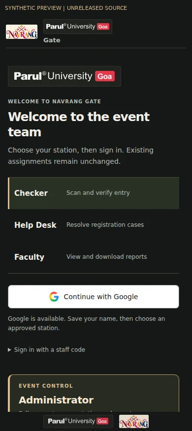
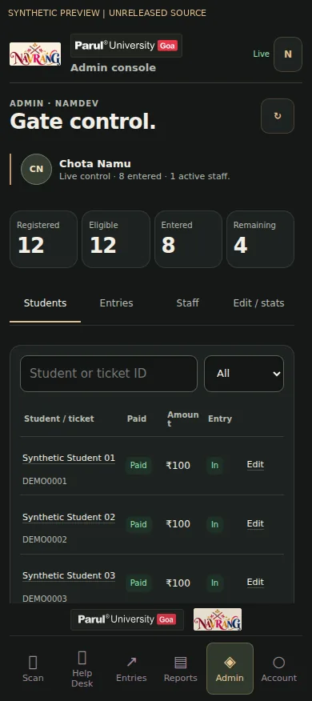
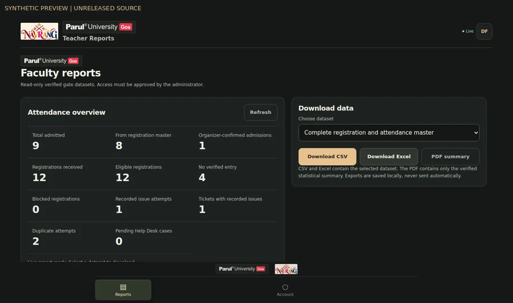

<div align="center">

# Navrang Gate
### Parul University Goa · Event entry and administration

**Scan confidently. Resolve exceptions. Report with evidence.**

[Download the current APK](https://github.com/Namdev90/paruluniversitygoa/raw/refs/heads/main/downloads/Navrang-Gate-0.7.6.apk) · [Complete feature catalogue](docs/FEATURES.md) · [Version history](CHANGELOG.md) · [Release handoff](docs/RELEASE-HANDOFF-2026-10-18.md)

</div>

> **Release status:** the public APK is **0.7.6 · Android code 14**. The visuals and Faculty Reports below show the **unreleased coordinated 0.7.7 candidate**, not an already downloadable update. Installer lifecycle PR #3 is merged source. The original signing key, final build and device validation remain required before publication. [`updates/latest.json`](updates/latest.json) is the actual update channel.

## Native Compose migration — source only

The isolated native rebuild is in `native-app/`. [Implementation and history audit](docs/NATIVE-IMPLEMENTATION-2026-10-18.md) · [N01–N18 parity and verification](docs/NATIVE-PARITY.md). Credential Manager, native workflows and independently scrollable lists are implemented in source. The owner deferred Google branding on 18 October; actual sign-in/device acceptance and production publication remain gated. No native APK has been released. The candidate previews below document the retained browser/legacy presentation.

## A look at the work

<table><tr><td width="50%" align="center"><br><strong>One clear entrance for every responsibility</strong></td><td width="50%" align="center"><br><strong>Gate control that remains readable on a phone</strong></td></tr></table>



**All preview records are synthetic.** These are rendered candidate-source screens, not production attendance screenshots or evidence of a published APK. Original university/event artwork is retained; no attendee information or credentials are embedded in these images.

## What Navrang Gate does

| At the gate | At the Help Desk | For faculty and administration |
|---|---|---|
| Continuous Android QR scanning, exact-ID fallback, focus/torch/zoom aids and distinct feedback. | Named, server-saved registration cases with duplicate safeguards and administrator review. | Searchable registration/entry views, staff permissions, and candidate read-only attendance reports. |
| Server-confirmed, single-use admissions; duplicate and pending outcomes remain explicit. | Payment and identity approval are deliberate; a case alone never authorizes entry. | CSV/XLSX datasets and PDF summaries distinguish evidence, missing records and organizer corrections. |

**Four roles, one permission model:** Checker · Help Desk · Faculty · Administrator. Faculty reporting is an approved read-only role in the candidate update. The administrator retains access to all stations and reports. Choosing a role in the interface never grants permission.

## Built for real gate conditions

- **Accountable outcomes:** stable request IDs, immutable receipt attribution, queued problem notices and late-response recovery. Green means a committed admission—not just a decoded QR.
- **Private by design:** server-owned records; RAM-only student copies; restricted staff summaries; guarded sign-out/late exports; no live roster, workbook or service secret in this repository or APK.
- **Safe updates:** original signing identity, package/version/hash checks, scan priority and unresolved-installation guards. Merged PR #3 adds process/reboot recovery; phone validation is still required for its release.

The [feature catalogue](docs/FEATURES.md) documents major and small behaviours: camera cancellation, inverted QR handling, named codes, station locking, Help Desk races, report provenance, formula-safe exports, branding, reduced motion, readiness controls, installer recovery and more.

## Reports that do not hide the exceptions

The candidate provides twelve dataset views: complete master, admitted, eligible without verified entry, blocked, recorded issues, resolved issues, unresolved issues, duplicate attempts, gate activity, Help Desk cases, pending cases and **“Admitted — registration data missing.”**

An organizer-confirmed admission is not presented as a payment verification. Unknown names and exact physical entry times stay unknown. “No verified entry” is not proof of absence. Duplicate scans are not extra people. See [reporting definitions](docs/FEATURES.md#faculty-reports--unreleased-app-candidate).

## Current installation and access

Install the current signed APK over the existing app; keep the same package and signing identity. Android may ask you to allow installation from the download source. Android 7+ and WebView/Chrome 86+ are required. Sign in with Google or an assigned staff code, save your real name and wait for the administrator's station approval.

The existing laptop portal is [Navrang Gate](https://navrang-gate-admin.namubhai.chatgpt.site). Its deployment is separate from a repository push; candidate screenshots do **not** establish that the hosted portal has been updated. The prepared browser companion must be deployed back to the same authorized site without changing its audience or access settings.

## Development and verification

```sh
npm ci --ignore-scripts
npm test
npm run test:native
python3 tests/sqlite-check.py
python3 tools/package-web.py .build/web-portal
```

The web package includes every referenced script, including Faculty Reports. `tests/responsive-browser-check.py` provides fixture-only layout checks with Python Playwright and local Chromium; see the [verification record](docs/VERIFICATION-2026-10-18.md) for exact viewports and limitations. Hosted suites require their dedicated synthetic credentials/state; do not run them against real attendee records.

**For signing:** follow [the original-environment handoff](docs/RELEASE-HANDOFF-2026-10-18.md). Do not create a new key or upload one here. No CI workflow in this repository signs releases or needs signing secrets.

## The development record

The project progressed through **14 archived APK versions**, from the 0.1.0 offline prototype to 0.7.6's UI-thread and camera responsiveness fixes. [CHANGELOG.md](CHANGELOG.md) links each version to its archive commit and explains what changed. The [archive inventory](docs/history/apk-inventory.json) records embedded package/version codes, byte sizes and hashes. Older architectures are documented, not silently restored.

## Project map

| Location | Contents |
|---|---|
| `native-app/` | Kotlin/Compose Android screens, CameraX, Credential Manager, native imports/exports and synthetic UI tests |
| `app/java/in/navrang/gate/` | Native scanner, sessions, runtime, document saving, readiness and updater |
| `app/assets/` | Shared web interface, report generators and original/licensed artwork |
| `server/` | Private-schema gate/report APIs, additive reporting migration and narrowly scoped historical reconciliation |
| `tests/`, `server/tests/` | Regression harnesses, source rendering and data/security checks |
| `tools/` | Packaging, original-art preparation, verification and guarded release tooling |
| `downloads/`, `updates/` | Published APK archive and actual update manifest |
| `docs/` | Features, operations, original signing handoff, sources and verification |

Created by **Namdev Shirodkar** for Navrang gate operations at Parul University Goa. Institutional/event marks remain their owners' artwork. Audio and asset provenance are documented in [asset notes](app/assets/art/ASSET-NOTES.md). No broader institutional endorsement or certification is implied.
