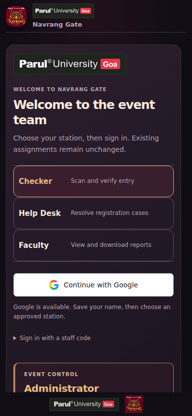
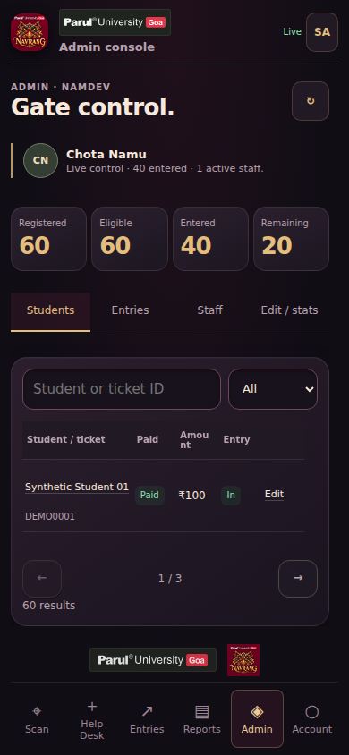

<div align="center">

# Navrang Gate
### Parul University Goa · Event entry and administration

**Scan confidently. Resolve exceptions. Report with evidence.**

[Download the current APK](https://github.com/Namdev90/paruluniversitygoa/raw/refs/heads/main/downloads/Navrang-Gate-0.8.0.apk) · [Complete feature catalogue](docs/FEATURES.md) · [Version history](CHANGELOG.md) · [GitHub Releases](https://github.com/Namdev90/paruluniversitygoa/releases) · [Release procedure](docs/RELEASE-PROCEDURE.md)

[Documentation index](docs/README.md) · [Contributing](CONTRIBUTING.md) · [Security](SECURITY.md) · [Accessibility](ACCESSIBILITY.md)

</div>

> **Release status:** **0.8.0 · Android code 18** includes the approved combined branding, staged sign-in, consolidated Reports with reachable downloads, sign-out confirmation and smoother transitions. Signed with the original identity. Communications features are deferred. Physical-device checks remain deferred by the owner; see [the release record](docs/RESTORATION-RELEASE-0.8.0.md).


## Original Navrang interface

The original screens use the existing local interface host with native Credential Manager/PKCE sign-in and CameraX scanning. Students and Entry log scroll independently while search stays reachable; the current release uses scroll-and-search lists without paging buttons. Bulk import, both staff permission flags, Help Desk, session security and installer recovery remain in the app. Twelve report datasets and exports are implemented in the released client/source. The 0.7.9 release record documents the deployed reporting repair, authenticated administrator summary and owner-confirmed CSV export; separately granted faculty and physical-device acceptance remain unverified. [Restoration details](docs/ORIGINAL-DESIGN-RESTORATION.md) · [Review disposition](docs/RESTORATION-REVIEW-2026-10-18.md).

The screenshots below preserve the **0.7.8 original-design checkpoint**, rendered with synthetic transport. They show historical page-arrow controls; 0.7.9 uses scroll-and-search lists. They are not physical-device captures, live attendance records or previews of an unpublished upgrade.

## A look at the work

<table><tr><td width="50%" align="center"><br><strong>One clear entrance for every responsibility</strong></td><td width="50%" align="center"><br><strong>Gate control that remains readable on a phone</strong></td></tr></table>

[Historical Faculty Reports preview](docs/screenshots/faculty-desktop.webp).

**All preview records are synthetic.** These are rendered source screens with fixture data; they do not establish physical-device or hosted-service acceptance. Original university/event artwork is retained; no attendee information or credentials are embedded in these images.

## What Navrang Gate does

| At the gate | At the Help Desk | For faculty and administration |
|---|---|---|
| Continuous Android QR scanning, exact-ID fallback, focus/torch/zoom aids and distinct feedback. | Named, server-saved registration cases with duplicate safeguards and administrator review. | Searchable registration/entry views, staff permissions, and read-only attendance reports. |
| Server-confirmed, single-use admissions; duplicate and pending outcomes remain explicit. | Payment and identity approval are deliberate; a case alone never authorizes entry. | CSV/XLSX datasets and PDF summaries distinguish evidence, missing records and organizer corrections. |

**Four roles, one permission model:** Checker · Help Desk · Faculty · Administrator. Faculty reporting is an approved read-only role. The administrator retains access to all stations and reports. Choosing a role in the interface never grants permission.

## Built for real gate conditions

- **Accountable outcomes:** stable request IDs, immutable receipt attribution, queued problem notices and late-response recovery. Green means a committed admission—not just a decoded QR.
- **Private by design:** server-owned records; RAM-only student copies; restricted staff summaries; guarded sign-out/late exports; no live roster, workbook or service secret in this repository or APK.
- **Safe updates:** original signing identity, package/version/hash checks, scan priority and unresolved-installation guards. Merged PR #3 adds process/reboot recovery; physical-phone acceptance remains unverified under the owner’s release waiver.

The [feature catalogue](docs/FEATURES.md) documents major and small behaviours: camera cancellation, inverted QR handling, named codes, station locking, Help Desk races, report provenance, formula-safe exports, branding, reduced motion, readiness controls, installer recovery and more.

## Reports that do not hide the exceptions

The app provides twelve dataset views: complete master, admitted, eligible without verified entry, blocked, recorded issues, resolved issues, unresolved issues, duplicate attempts, gate activity, Help Desk cases, pending cases and **“Admitted — registration data missing.”**

An organizer-confirmed admission is not presented as a payment verification. Unknown names and exact physical entry times stay unknown. “No verified entry” is not proof of absence. Duplicate scans are not extra people. See [reporting definitions](docs/FEATURES.md#faculty-reports).

## Current installation and access

Navrang Gate is for authorized event staff, faculty and administrators. Downloading the app or choosing a station does not grant access. Attendees should contact the event organizer for ticket, payment or entry questions.

1. On Android 7 or newer with WebView/Chrome 86 or newer, download the current APK above. For an upgrade, install over the existing signed app without uninstalling; older versions before 0.4 need this manual upgrade once. You do not need every intermediate APK.
2. Open the APK and follow Android's installation prompts. Grant installation permission only to the source you intentionally used, and keep Android's security checks enabled. A package/signature mismatch needs maintainer help; do not uninstall to bypass it.
3. Sign in with Google or an assigned staff code, save your real name and wait for administrator approval of the appropriate station. Faculty reporting uses Google sign-in and a separate read-only grant. Administrator access is separate.
4. Allow the camera when scanning is needed. Notifications are optional; Android still asks before installing an app update. Internet is required for admission confirmation and Help Desk saves. A decoded QR or pending result alone never permits entry.

See [updates and interrupted-install recovery](docs/APP-UPDATES.md) and the [role reference](docs/FEATURES.md#four-clearly-separated-responsibilities).

The existing laptop portal is [Navrang Gate](https://navrang-gate-admin.namubhai.chatgpt.site). Its deployment is separate from a repository push; candidate screenshots do **not** establish that the hosted portal has been updated. The current hosting audience is public, while operational records require app/server authentication. The [0.7.9 release record](docs/RESTORATION-RELEASE-0.7.9.md#original-key-apk-publication-receipt) records the separately published phone download-layout correction as Site version 11. Future companion deployments must follow [the portal parity plan](docs/PORTAL-DEPLOYMENT.md) on the same site without changing its audience, authentication or backend.

## Help and safe reporting

For ordinary software bugs or feature requests, use [GitHub Issues](https://github.com/Namdev90/paruluniversitygoa/issues) and follow [Contributing](CONTRIBUTING.md). Include the app version, affected screen, device/browser and reproduction steps using synthetic or carefully redacted evidence. For staff approval, ticket/payment questions or event-day entry decisions, contact your event organizer through your existing verified channel. Use [Security](SECURITY.md) for a suspected vulnerability and [Accessibility](ACCESSIBILITY.md) for access barriers.

Operational caches are RAM-only, but reports you choose to download and screenshots you capture can remain on your device after sign-out. Store and share those copies appropriately. Never put attendee QR codes, contact/payment details, staff codes, credentials or unredacted diagnostic records in public issues.

## Development and verification

```sh
npm ci --ignore-scripts
npm test
npm run test:native
python3 tests/sqlite-check.py
python3 tools/package-web.py .build/web-portal
```

The web package includes every referenced script, including Faculty Reports. `tests/responsive-browser-check.py` provides fixture-only layout checks with Python Playwright and local Chromium; see the [0.7.9 release evidence](docs/RESTORATION-RELEASE-0.7.9.md) and [earlier dated verification record](docs/VERIFICATION-2026-10-18.md) for source versions, viewports and limitations. Hosted suites require their dedicated synthetic credentials/state; do not run them against real attendee records.

**For signing:** follow [the current original-environment release procedure](docs/RELEASE-PROCEDURE.md). Do not create a new key or upload one here. No CI workflow in this repository signs releases or needs signing secrets.

## The development record

The project preserves its APK history from the 0.1.0 offline prototype through native rebuilding and subsequent releases. [CHANGELOG.md](CHANGELOG.md) links versions to their archive commits and explains what changed. The bounded [historical inventory](docs/history/apk-inventory.json) covers the first **17 versions, 0.1.0–0.7.9**, including embedded package/version codes, byte sizes and hashes. Those 17 versions are available as [GitHub archive Releases](https://github.com/Namdev90/paruluniversitygoa/releases), published and independently verified on 19 October 2026 with original APKs, checksums and source-commit provenance. Older architectures remain clearly labelled. The [publication receipt and policy](docs/history/GITHUB-RELEASES.md) distinguish actual GitHub publication times from original archive dates. Newer app releases follow the current download and updater channel above; the historical migration does not change that channel.

## Project map

| Location | Contents |
|---|---|
| `native-app/` | AndroidX interface host, Kotlin/Compose scanner, CameraX, Credential Manager, native imports and synthetic UI tests |
| `app/java/in/navrang/gate/` | Native scanner, sessions, runtime, document saving, readiness and updater |
| `app/assets/` | Shared web interface, report generators and original/licensed artwork |
| `server/` | Private-schema gate/report APIs, additive reporting migration and narrowly scoped historical reconciliation |
| `tests/`, `server/tests/` | Regression harnesses, source rendering and data/security checks |
| `tools/` | Packaging, original-art preparation, verification and guarded release tooling |
| `downloads/`, `updates/` | Published APK archive and actual update manifest |
| `docs/` | Features, operations, original signing handoff, sources and verification |

Created by **Namdev Shirodkar** for Navrang gate operations at Parul University Goa. Institutional/event marks remain their owners' artwork. Current logo provenance is documented in [artwork notes](docs/ARTWORK.md); historical audio and asset sources remain in [asset notes](app/assets/art/ASSET-NOTES.md). No broader institutional endorsement or certification is implied.

## License and artwork

The project code and documentation are provided under the existing [MIT License](LICENSE), copyright © 2026 Namdev90. This update preserves that license and copyright notice. Bundled libraries keep their own licenses; university/Google marks and organizer-supplied artwork retain their own rights. The historical Navrang Gate app mark is owner-approved generated/edited artwork, not independently authenticated institutional branding. See [third-party notices](THIRD-PARTY-NOTICES.md), [artwork provenance](app/assets/art/ASSET-NOTES.md) and the bundled audio notices.

## Next upgrade

The [current checklist](docs/NEXT-STEPS.md) records the deeper original-style visuals, background-free logo treatments, non-overlapping intro, scroll-and-search lists, in-camera exact-ID search and permission-appropriate receipt details delivered in 0.7.9, alongside remaining acceptance work. Future changes must be demonstrated in their own candidate and pass independent review before a new signed release is advertised here. The download above is the published 0.7.9 release; the checklist retains the implementation and acceptance history that led to it. Any later candidate needs its own verified signed release before replacing that download.
