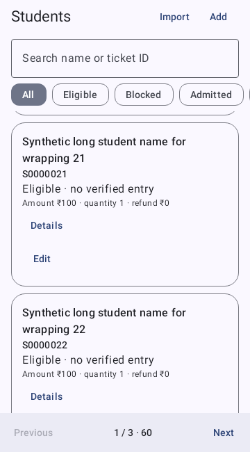
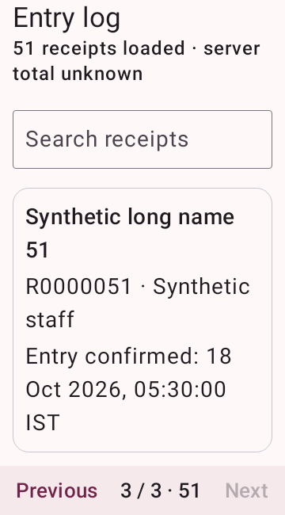

# Native migration parity and release hold

Source is isolated on `codex/native-compose-rebuild`. All operational Android screens are Compose in `native-app/src/main/kotlin/in/navrang/gate`; the legacy WebView activities are excluded from this module, retained for the separate portal and regression comparison. This is an implementation checkpoint, **not a released native replacement**.

Status vocabulary: NOT STARTED, IMPLEMENTED—UNVERIFIED, VERIFIED AUTOMATED, VERIFIED DEVICE, BLOCKED, RELEASE-READY. Automated evidence never substitutes for a phone test. `docs/native-release-evidence.json` is deliberately fail-closed.

| ID | Existing source / role / contract | Native implementation and behavior | Evidence and current status |
|---|---|---|---|
| N01 | MainActivity/brand-shell; all | MainActivity splash; GateApp Intro/BrandMarks; authentic crop, dancers, audio, Skip, reduced motion, returning-session fast path | Compiles; launch/brand rendering and API-24 phone checks pending. IMPLEMENTED—UNVERIFIED |
| N02 | client.js/MainActivity; all; login/checker-login/google-login | Credential Manager Google ID token → Supabase ID-token exchange → existing Google login; raw/hashed nonce pairing; PKCE fallback and generation-checked callback; separate admin/code inputs | Google web client identified from live provider redirect. Actual Cloud branding/Android OAuth association/account picker not verified. BLOCKED |
| N03 | gate.js; checker/faculty; checker-profile/staff-request/reports-request/me | StationScreen/name dialog; server-controlled grants, saved station, real name and expiry | Domain authorization checks automated; actual account lifecycle pending. IMPLEMENTED—UNVERIFIED |
| N04 | all routes; server roles | Material app shell, NativeDestinations, adaptive navigation rail, role-filtered destinations, pending-save guard | Compiles; multiwindow/back/TalkBack device pass pending. IMPLEMENTED—UNVERIFIED |
| N05 | home; scanner-approved staff/admin; sync/checkin | CheckerScreen, exact ID fallback, own scans/total entries only for staff, connection and pending status | Existing runtime guards retained; device exercise pending. IMPLEMENTED—UNVERIFIED |
| N06 | ScanActivity/QrCodec; canScan | CameraX lifecycle/backpressure worker, exact QR contract, framing/focus, automatic/manual torch, bounded automatic/manual zoom/reset, short-window scrollable controls, permission fallback and low-light guidance | QR tests; actual camera, focus, latency and lifecycle measurements pending. IMPLEMENTED—UNVERIFIED |
| N07 | pending handlers/ScanTimeouts; scanner roles | ScanOutcomes RAM-only deadlines, queued acknowledgement, late receipt reconciliation, distinct labeled outcomes | NativeDomainTest covers retries, timeout, late success and queued outcomes; physical scan flow pending. VERIFIED AUTOMATED (domain only) |
| N08 | view-entries; admin only; authorized sync pages | EntriesScreen reads complete RAM ledger, loaded/server counts, stable search/pager, correction/observed time labels | StableListsTest scroll/bounds/provenance; no staff roster expansion. Empty/one-row/loading/error/last-page, large-font and remaining device/accessibility evidence tracked below. VERIFIED AUTOMATED (specified cases) |
| N09 | admin registrations; admin; upsert/import | StudentsScreen lazy cards, search/filter/25-row data pages; per-ticket read-only details and edit/add; bounded CSV/XLSX import preview and explicit replacement confirmation | StableListsTest plus import tests. Private workbooks and device picker pending. VERIFIED AUTOMATED (specified cases) |
| N10 | admin entries/stats; admin; sync | Complete receipts, summary, correction uncertainty, preserved server counts | SQL/report source regressions; deployed RPC fixes not applied. IMPLEMENTED—UNVERIFIED |
| N11 | staff/code dialogs; admin; staff-create/staff-update | Native staff cards/forms, code creation, name/assignment, active/revoke, expiry display; reports managed separately | Server remains authority. Actual synthetic account lifecycle pending. IMPLEMENTED—UNVERIFIED |
| N12 | desk form; approved desk/admin; helpdesk-save/edit | Four fields, fee preview, validation; UUID/payload retained for uncertain retry; RAM-only drafts | Validation tests; interrupted network/device tests pending. IMPLEMENTED—UNVERIFIED |
| N13 | desk list/review; role-limited; helpdesk-list/review | Native paged list/search/status, details/attribution/version, pending edits, explicit identity/payment approval and reject confirmation | Existing server/DOM tests retained; native end-to-end pending. IMPLEMENTED—UNVERIFIED |
| N14 | reports.js; approved faculty/admin | All twelve dataset definitions, live summary, independent faculty management errors, grant/revoke | Export/domain tests; all datasets against dedicated synthetic backend pending. IMPLEMENTED—UNVERIFIED |
| N15 | report-export/MainActivity; restricted exports | Native CSV, OOXML XLSX, truthful PDF summary, bounded RAM buffers, document picker, generation/access checks, erase buffers | Formula/XML/buffer tests; picker cancel/revocation/device tests pending. IMPLEMENTED—UNVERIFIED |
| N16 | account/readiness; signed in | Light/dark/system/dynamic/reduced motion, real Android permissions/notifications, existing sound policy, signout/about/update controls | Compiles; full appearance/accessibility/device behavior pending. IMPLEMENTED—UNVERIFIED |
| N17 | GateUpdater/UpdateJob/Receiver; signed app | Existing updater/signature/hash/package/installer/session fences retained, native status/progress/actions; internal package cannot self-update | Existing 118 updater harness checks pass; actual native in-place upgrade/reboot/cancel pending. IMPLEMENTED—UNVERIFIED |
| N18 | all dialogs/loading/errors; role-controlled | Native Material dialogs, menus, progress, validation, empty/error states; no operational WebView | Native secondary UI includes export cancellation and pending-work exit warnings. Domain tests cover expiry authorization; full visual/accessibility/IME pass pending. IMPLEMENTED—UNVERIFIED |

## Scrolling evidence

`StableListsTest` renders actual Compose Students and Entry log with synthetic rows at 360 dp width. It covers empty, one-row, loading/error and last-page fixtures, a 2× font-scale Entry log and light/dark fallback themes. It scrolls to row 21, checks the row-specific Edit target and correction labels, verifies search and pager bounds remain exactly unchanged (0 px tolerance), checks navigation availability and distinguishes 40 loaded receipts from 793 server results. This is host-rendered Robolectric evidence, not touch/keyboard/TalkBack or phone evidence.

`tests/responsive-browser-check.py` independently renders the real portal DOM/CSS/JS with synthetic transport and RAM storage. It measures both row scrollers and fixed controls at eight viewports (320×640 through 1920×1080, including 640×360), plus all prior role/view checks. Production CSP is omitted only from the test wrapper; no fixture transport is shipped. The deployed portal has not been changed by these source tests.

## Release constraints

No release version has been allocated. Public baseline remains 0.7.6 / code 14. Internal debug suffix `.internal` prevents in-place replacement and disables production callbacks/updating. Production ID remains `in.navrang.gate`. No real attendees are used as admission fixtures. No private screenshot, mail body, student record, credential, signing material or provider secret belongs in this repository.

`python tools/build.py` now selects the native, evidence-gated build. A separately approved legacy hotfix must deliberately use `--legacy-approved-hotfix`; it does not complete the native migration. Native signing retains the original-key requirement and existing APK signer/package/version verification, then the publication/anti-rollback checks. An unsigned or internal APK is never a release. Device, performance, hosted portal, backend review and independent Google branding evidence remain mandatory; paid domains require explicit approval.

## Automated verification at this checkpoint

- Clean Gradle `assembleDebug`, `testDebugUnitTest` and `lintDebug`: **passed**. Lint has 0 errors and 29 warnings (including retained Java preference/resource patterns and Kotlin convenience suggestions); no lint baseline hides findings.
- Node/server/source regressions: **164 passed, 3 skipped**, 167 total. Skipped dependency/environment cases are not counted as passes.
- Existing Java runtime harnesses: **308 checks passed**, including 118 secure-session, 26 camera lifecycle, 30 runtime, 5 pending-result, 11 acknowledgement queue and 118 updater checks.
- Native domain: **30 passed** (15 cases each under Robolectric API 24 and API 35). Four Compose list tests passed under API 35; these are host tests, not attached-device results.
- Portal: **120 synthetic checks passed** across eight viewports; no console errors or unexpected actions. Fixed-control bounds tolerance is 1 px for browser rendering, 0 px for the selected Compose checks.
- In-memory SQLite, seven existing release-policy checks and two native release-gate checks passed. The default build entry point refused to build/sign while N01–N18 evidence remains incomplete.
- Internal APK manifest was inspected: `in.navrang.gate.internal`, version `0.7.6-native-internal`, code 14, minimum API 24, target API 37. It contains no operational HTML/JavaScript assets and is not a release candidate for distribution.

API-24 host tests do not test a camera, Google Play account picker, installed-user upgrade, Android installer/reboot, device accessibility or hardware performance. No claim of those outcomes is made. The full dedicated-account DOM/hosted integration suite remains unrun without its synthetic credentials/environment.

## Synthetic native list renders

These are actual Compose list components rendered on the host, with synthetic records. They do not show the complete app shell or establish phone/device acceptance. The capture clock is advanced before snapshots so Material text rendering has settled after fixture updates.

| Students, scrolled | Entry log, doubled text size |
|---|---|
|  |  |

[Dark last-page fixture](native-screenshots/students-last-page-dark.png) · [Correction provenance fixture](native-screenshots/entries-synthetic.png)
